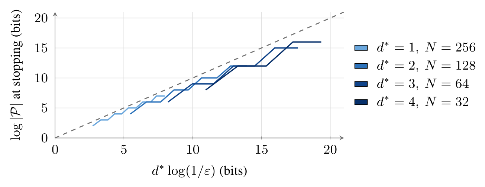
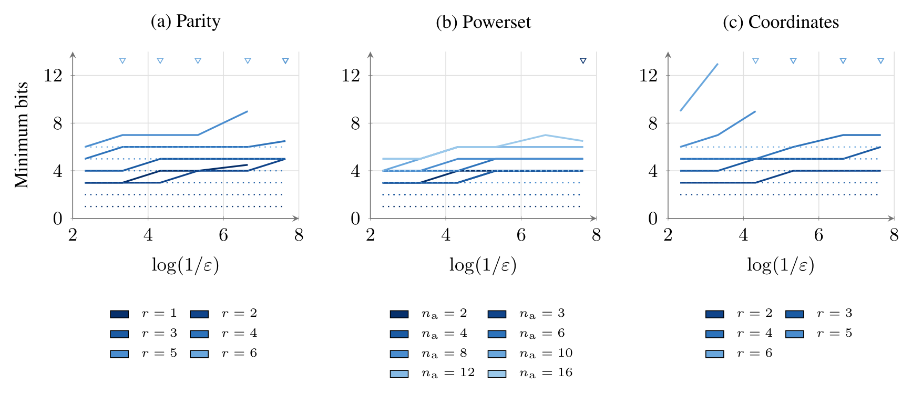
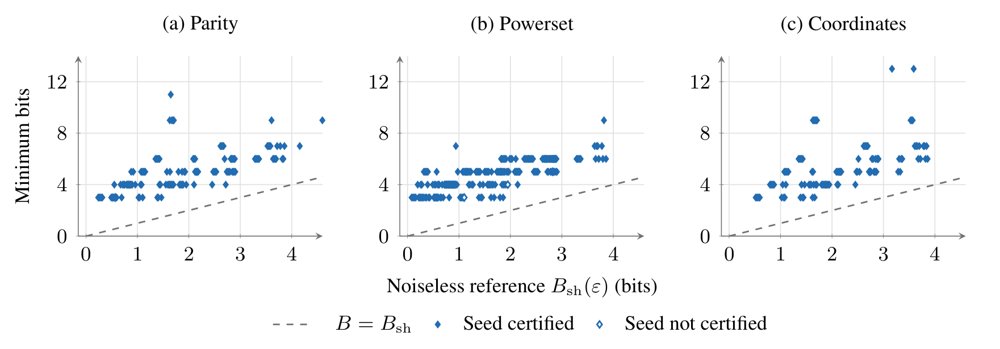
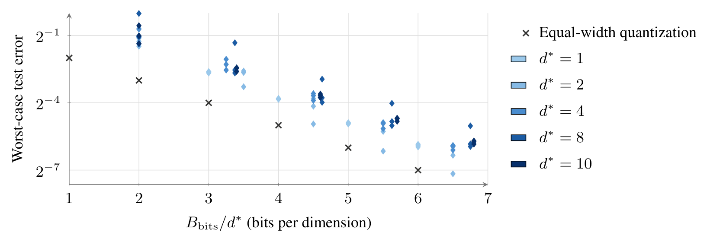

# Communication Complexity of Universal Features

## About
How many bits must a task-agnostic representation retain to accuractely answer every task in a family? We show that `Theta(d* log(1/eps))` bits are sufficient and worst-case optimal, where `d*` is the dual VC dimension.

These experiments:

1. Verify the greedy algorithm's accuracy-size tradeoff on threshold-product families
2. Train reconstruction-based top-k sparse autoencoders (SAEs) on powerset, parity, and coordinate families, comparing the minimum bit budgets against theoretical bounds
3. Evaluate reconstruction-trained SAEs on threshold-product families over [1024]^r, measuring worst-case prediction error as a function of bits per dimension

## Setup

Python 3.13 or newer is required.

```sh
bash scripts/setup.sh
```

## How to run

```sh
scripts/run.sh                                           # run all three experiments
scripts/run.sh configs/analysis.json                     # analysis of the saved outputs
```

## Results

<details>
<summary><strong>Greedy construction on the threshold product</strong></summary>



Representation size of the maximum-error greedy construction on threshold products, plotted against `d* log(1/eps)`.
The curves follow `d* ceil(log2(1 / (2 eps)))`; the dashed line is `y = x`.

</details>

<details>
<summary><strong>Finite-family capacity saturation</strong></summary>



Minimum tested bit budget passing validation at each error target, shown as the median over seeds with a configuration.
Dotted lines indicate the lossless reference `B_0`.
Open triangles indicate instances for which no configuration passes validation.



Bit budgets against the shattered-set bound `B_sh(eps)`, one point per selected seed with offsets for visibility.
Filled dots were certified on test; the dashed line is `B_bits = B_sh(eps)`.

</details>

<details>
<summary><strong>Accuracy-bit tradeoffs on threshold products</strong></summary>



Worst-case error against the bit budget per dimension for reconstruction-trained SAEs, one dot per random seed (three per dimension) for each `d*` in `{1, 2, 4, 8, 10}`.
× are the exact error `2^(-l - 1)` of equal-width quantization using `l` bits per coordinate.
Prediction error decreases as the representation budget increases.

</details>

## License 
[MIT License](LICENSE)
